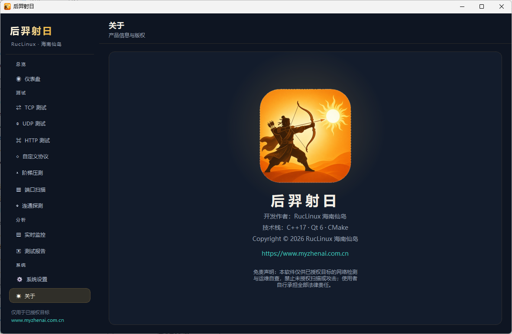
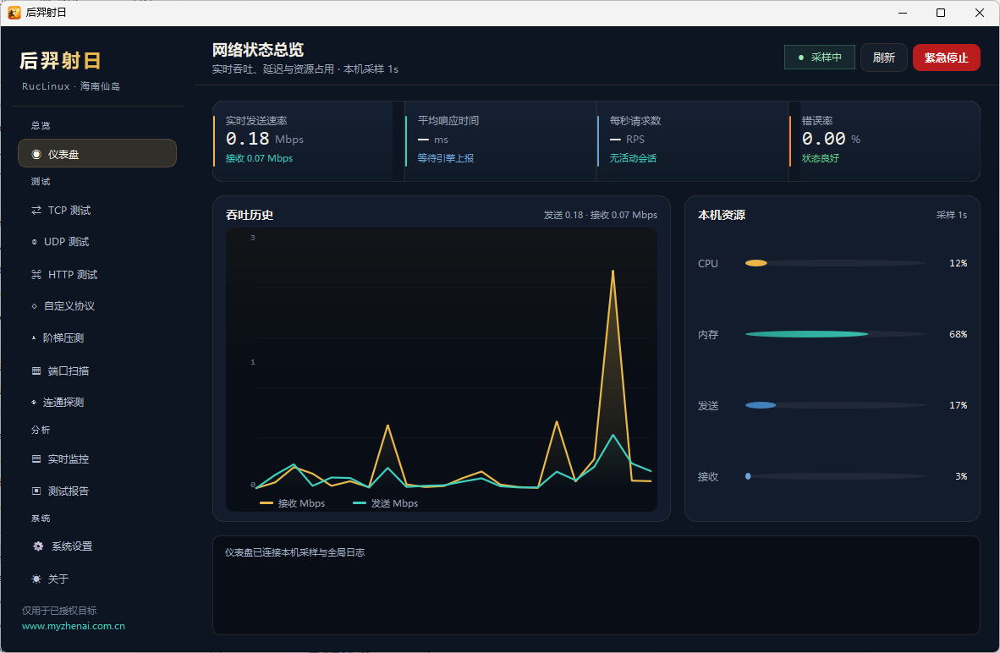
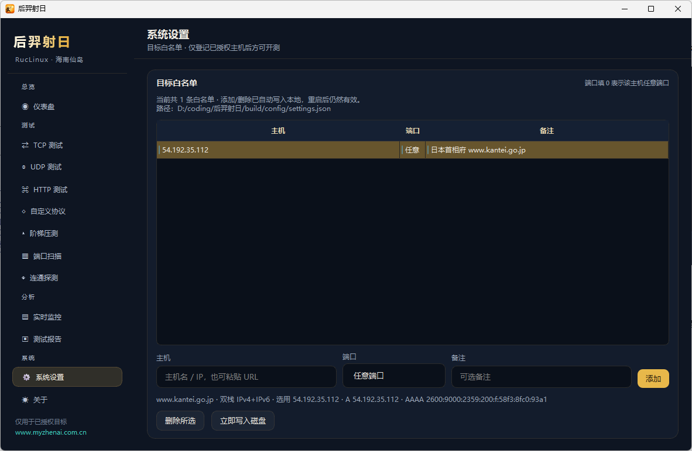
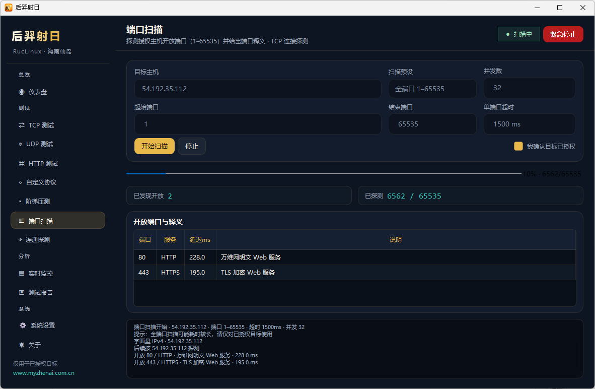

# 后羿射日

**后羿射日**是由 **RucLinux 海南仙岛** 打造的 Windows 桌面端**授权目标网络测试工具**。面向运维、研发与授权安全评估场景，纯 C++/Qt6 中文深色界面，覆盖 TCP / UDP / HTTP、自定义协议、阶梯压测、端口扫描与连通探测，并把每次实验的参数与结果写入可导出的测试报告。

| 项目 | 内容 |
|------|------|
| 官网 | [www.myzhenai.com.cn](https://www.myzhenai.com.cn) |
| 版本 | v0.1.0 |
| 技术栈 | C++17 · Qt 6 · CMake |
| 界面 | 全中文 · 日晕金 × 夜空墨 |

---

## 一、它适合做什么

- 对**已明确授权**的内网主机、自有业务域名做连通性与容量摸底
- 对比不同超时、并发、速率下的成功率与延迟分布（P50 / P95 / P99）
- 扫描授权主机开放端口，并查看常见端口中文释义
- 用 ICMP / SYN 做轻量连通探测，辅助排查链路问题
- 把完整「测试参数 + 结果指标」沉淀为报告，便于复盘与留档

**不适合：** 对未授权目标的扫描、压测或攻击性探测。软件内置白名单闸门与禁止目标列表，开测前必须确认授权。

---

## 二、核心能力一览

| 模块 | 作用 |
|------|------|
| 仪表盘 | 总览运行状态与关键指标入口 |
| TCP 测试 | 连接建立延迟、成功率、按「时长 × 每秒次数」探测 |
| UDP 测试 | UDP 发送探测与耗时统计 |
| HTTP 测试 | HTTP/HTTPS 请求压测（方法、头、Body 可配） |
| 自定义协议 | TCP/UDP 帧头帧尾、编码与响应匹配规则 |
| 阶梯压测 | 固定 / 自动 / 手动阶梯抬升速率，观察拐点 |
| 端口扫描 | 常用端口表或 1–65535 全端口 TCP 探测 |
| 连通探测 | ICMP Echo、SYN 半开探测 |
| 实时监控 | 本机资源与吞吐观察 |
| 测试报告 | 会话预览、历史、CSV / HTML 导出 |
| 系统设置 | 目标白名单（本地持久化，重启仍保留） |

---

## 三、安全机制（请先读）

### 1. 白名单

所有开测动作都会经过安全校验：目标主机必须事先登记在**系统设置 → 目标白名单**中，并勾选「我确认目标已授权」。端口填 `0` 表示该主机任意端口均可测（整机授权）。

白名单会**自动写入本机用户配置目录**（添加/删除即保存），重新编译或重启程序后仍会读入，无需每次重填。设置页会显示具体保存路径。

### 2. 域名自动解析

主机输入框支持主机名、IP，也可粘贴 URL。失焦或回车后会自动 DNS 解析，并标明**仅 IPv4 / 仅 IPv6 / 双栈**；双栈时优先选用 IPv4。加入白名单时同样会解析为 IP，备注可保留原域名。

### 3. 禁止目标

软件内置禁止域名/IP 列表（含解析缓存）。命中禁止目标时即使加入白名单也会被拦截，用于降低误伤风险。

### 4. 紧急停止

任意测试页右上角「紧急停止」可协作中止正在运行的引擎（含扫描 / ICMP / SYN），用于异常情况下快速收束流量。

> **免责声明：** 后羿射日仅供对**已获书面或明确授权**的目标进行连通与性能评估。使用者须自行确保合法合规；因未授权探测造成的后果由使用者自行承担。

---

## 四、快速上手（5 步）

1. **启动程序**：运行安装目录或开发包中的启动脚本（例如 `启动后羿射日.bat`），进入中文深色主界面。
2. **登记白名单**：打开左侧「系统设置」→ 填写主机（可填域名，自动解析为 IP）→ 端口填 `0` 或具体端口 → 点「添加」。条目会自动落盘。
3. **选择模块**：在侧栏进入 TCP / HTTP / 端口扫描等页面，确认目标与白名单一致。
4. **自选参数**：测试时长、每秒次数、阶梯速率、探测间隔/超时等均可按实验需要填写，便于做对照实验。
5. **勾选授权并开始**：勾选「我确认目标已授权」→「开始」→ 观察结果卡片与日志；结束后到「测试报告」查看参数与指标并导出。

---

## 五、各模块使用要点

### TCP / UDP / HTTP / 自定义协议

- **测试时长（秒）**与**每秒次数**由你设定；报告会原样记录，便于复现实验条件。
- TCP 关注连接建立是否成功与延迟；UDP 关注发送与耗时；HTTP 需填写完整 URL（主机须在白名单）。
- 自定义协议可配置传输方式、编码、帧头/帧尾与响应匹配规则，适合私有报文联调。
- 结果区展示成功/失败次数、平均延迟等；日志区输出过程明细。

### 阶梯压测

支持三种模式：

- **固定阶梯**：按阶段数与每阶递增抬升
- **自动阶梯**：升至上限，或错误率超过「停测错误率」时停止
- **手动阶梯**：每阶段结束后由你决定是否「下一阶梯」

起始速率、递增、上限、阶段秒数、并发等参数均可自选。图表与阶段表用于观察延迟与错误率随速率变化的拐点；报告中会附带各阶段明细。

### 端口扫描

- 预设：常用端口表 / 1–1024 / 全端口 1–65535 / 自定义范围
- 可调单端口超时与并发；全端口扫描前会二次确认
- 结果表**仅列出开放端口**，并附服务名与中文说明
- 日志会输出 DNS 摘要（IPv4/IPv6）与探测统计（开放 / 关闭 / 过滤超时）

**提示：** 若目标写成带 `https://` 的完整网址，程序会自动提取主机名；海外站点或 CDN 在超时过短、并发过高时可能大量显示「过滤/超时」，请适当加大超时并优先观察 80/443 等常用端口。

### 连通探测（ICMP / SYN）

- **ICMP**：次数、超时、间隔可自选；查看每次 RTT 与平均时延（部分环境可能需要管理员权限）
- **SYN**：对指定端口做半开探测；次数与超时可自选，并显示端口释义

---

## 六、测试报告怎么用

每次开始测试，系统都会创建会话，并写入：

- **测试参数**：目标、时长、速率、阶梯配置、扫描范围、探测次数/超时等（完整可复现）
- **汇总指标**：成功/失败、平均延迟、P50/P95/P99、RPS、错误率、本机 CPU/内存峰值
- **阶梯阶段**（若有）：每阶段速率、并发、延迟与错误率

在「测试报告」页可预览当前/历史会话，并导出 **CSV** 或 **HTML**（可用浏览器打开后打印为 PDF）。做科学对比时，请固定除自变量外的参数，并保留报告中的参数段作为实验条件说明。

---

## 七、推荐实验习惯

1. 先用小时长、低速率做通断确认，再抬升压力。
2. 一次只改一个变量（例如只改每秒次数），其余参数写进报告对照。
3. 对公网或 CDN 目标，超时宜留余量；全端口扫描只对授权内网或明确允许的目标进行。
4. 压测与扫描会产生真实网络负载，避开业务高峰，并提前告知相关方。
5. 使用「紧急停止」作为最后手段，避免异常循环占用资源。

---

## 八、常见问题

### 弹出「安全拦截」？

目标不在白名单、未勾选授权确认，或命中禁止目标。到系统设置添加主机后重试；域名会解析成 IP，请确认白名单中是解析后的地址（或重新添加一次）。

### 白名单重启后不见了？

新版本已改为写入用户配置目录，避免被编译输出覆盖。请查看系统设置页提示的路径；添加后即自动保存。

### 端口扫描开放数为 0？

结果表只显示**开放**端口。超时过短、主机不可达、防火墙丢包都会记为过滤/超时。请检查主机是否解析正确，并加大单端口超时后重试。

### 实际 RPS 低于我填的「每秒次数」？

串行连接时，单次握手耗时会限制可达吞吐。报告中的 RPS 与延迟更能反映真实情况；需要更高吞吐时可结合阶梯并发等参数做多组对照。

---

## 十、写在最后

**后羿射日**把「授权可控、参数可自选、结果可复盘」放在同一套中文工具里：先白名单、再开测、后出报告。更多信息见 [www.myzhenai.com.cn](https://www.myzhenai.com.cn)。

Copyright © 2026 RucLinux 海南仙岛 · 后羿射日 v0.1.0
